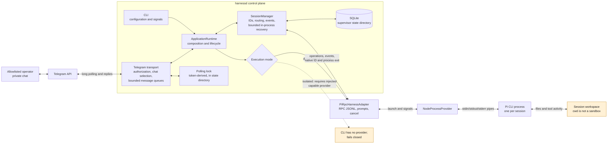

# How harnessd works

harnessd is a local supervisor for Pi coding-agent sessions. An allowlisted operator controls it through a private Telegram chat. The service translates Telegram updates into adapter-neutral session operations; the core owns session identity and lifecycle, while the Pi adapter owns the RPC protocol.

## Component map

The transport, core, harness, and process provider are separate boundaries. Core does not import Telegram or Pi protocol code. SQLite stores supervisor metadata and native session IDs under a configured state directory, independently of each session's workspace. It does not store prompt/event history.

## A request and response

1. The CLI validates configuration, opens supervisor state, builds the runtime, and waits for Telegram polling readiness.
2. Before a Telegram update reaches the core, middleware requires an allowlisted numeric sender and a private chat. Selection of a session is kept in memory per chat.
3. A command or text update becomes a typed runtime request. `SessionManager` routes it by supervisor `SessionId` to the matching Pi RPC instance.
4. Pi communicates with its adapter using line-delimited JSON over standard input/output. The adapter decodes events and acknowledgements; the runtime returns safe results to Telegram.
5. Live events are tagged with their supervisor session ID and sent in order to chats that have selected that session, subject to bounded queues. Chat selection and event history are not persisted.

## Process failure and uncertain input

While harnessd is running, the core watches the process exit separately from RPC stream EOF and drains final events. If a process exits unexpectedly, an unsettled input is surfaced as `uncertain` with its original `InputId`; it is **never automatically resent**. The watchdog may make at most three native-session resume attempts for that supervisor session, after 250 ms, 1 s, and 4 s. Resume uses the exact saved native ID; it never creates a fresh session as fallback. A later operator submission is new work and may duplicate work if the earlier uncertain prompt actually completed.

After harnessd itself exits, existing SQLite rows do not prove that their Pi processes still exist. This CLI does not reattach or restart prior Pi processes. A restarted service may list stale rows, but `/use` cannot restore sessions from the previous service run.

## Trust and limitations

- `direct` is the trusted default. Pi runs with the supervisor user's operating-system permissions. Choosing a `cwd` is not sandboxing; the process can access other files available to that user and can write data into its workspace.
- The CLI does not provide an isolation provider. Explicit `isolated` selection fails safely; it never falls back to direct execution.
- All allowlisted Telegram operators share local session authority. Harness output may include sensitive workspace data; it is not universally redacted, and bounded queues may omit notifications under backpressure.
- The Pi child does not inherit the supervisor's entire environment. Do not assume that exporting a model/API credential in the shell configures Pi for harnessd; use Pi's supported configuration or an explicitly supported environment mechanism.
- There is no secret wallet, durable chat selection, durable event/input history, or supervisor-restart recovery.
- The Telegram polling lock protects only processes sharing the configured state directory; it cannot stop an unrelated program from polling the same bot token.

See the [README](../README.md) for installation and operation, and the [package-release contract](contracts/surfaces/package-release.md) for versioning and Git installation.
